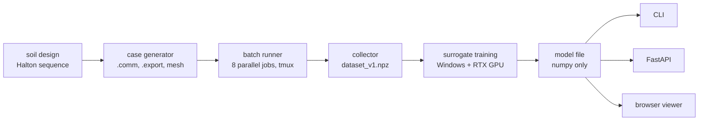

# A Gaussian-process surrogate for raft impedance

*Write-up of the surrogate, 6 October 2026. Release model: 512 soils ×
5 footprints + rotated twins (5,120 cases), trained on the GPU with `python -m surrogate train`.*

## Summary

Seismic soil–structure interaction (SSI) analyses need the impedance of the foundation: a
6 × 6 complex matrix per frequency that says how stiff the soil is under the raft and how
much energy it radiates away. A boundary-element run with MISS3D gives it in 20 s to 7 min per
case, which is fine once but rules out sensitivity studies, Monte Carlo on soil uncertainty or
interactive design. I built the whole pipeline to replace those runs with a learned model:

1. **Data engine:** Python automation of code_aster/MISS3D on Linux that generated, ran and
   collected 3,232 simulations (5 raft footprints × space-filling soil designs, 18 h of batch time).
2. **Surrogate:** Gaussian processes that predict 8 impedance terms over 0.45–15 Hz from 10
   inputs (7 layer thicknesses, a stiffness factor, raft length and width), with an uncertainty
   band. On soils never seen in training the mean error is **2.9 %** (the worst term within
   8.6 % for 95 % of soils), the 95 % band holds 98 % of the simulated values, and a prediction
   takes a few milliseconds: 5,000 to 100,000 times faster than MISS3D, depending on the raft.
3. **Product:** a numpy-only model file, a command line, a FastAPI service (with a Dockerfile)
   and an interactive browser viewer that runs the model client-side.

Stack: Python, numpy, scikit-learn, PyTorch + GPyTorch (GPU), FastAPI, Docker, Jupyter;
code_aster and MISS3D on Debian.

## 1 · The problem

The impedance K(f) of a rigid raft depends on the soil profile and the raft's plan dimensions.
For a layered site it ripples with frequency (layer resonances), and its imaginary part
carries radiation damping. An SSI study needs K(f) for many soil variants: best estimate, lower
and upper bounds, and ideally a probabilistic spread. Each variant is one MISS3D run.

A surrogate model learns the map *inputs → curves* from a set of runs, then answers new
queries instantly. The questions that decide whether it is useful: how accurate, on what kind
of new case; whether it knows when it is unsure; and what it makes possible.

## 2 · Data

- **Site:** seven strata over bedrock (Vs 500–1,200 m/s, bedrock 1,600 m/s). Thicknesses vary
  within site ranges; a factor g scales the shear modulus of all strata (×/÷ 1.5).
- **Footprints:** 30 × 15, 45 × 15, 60 × 15, 80 × 20 and 33 × 31 m. The same soils run on every
  footprint (a crossed design), so differences between footprints are not confounded with soil.
- **Split:** Halton training soils (512 per footprint; 1,024 for 33 × 31) and 32 random hold-out
  soils per footprint, never used for training or tuning: 3,072 + 160 cases.
- **Checks before modelling** (notebook 01): no NaN or zero terms; the asymmetry K_ij − K_ji
  is below 0.05 % from 0.45 Hz up; the reference-point offset of one mesh corrected exactly by
  a rigid-body transfer; the 0.2 Hz point dropped as unreliable; the band limited to 15 Hz, above
  which impedances fluctuate (as also seen in full FE models) and SSI of these buildings is
  governed by lower frequencies.

## 3 · Method

**Targets.** 8 terms (6 diagonal + the two sway–rocking couplings) × 59 frequencies × (Re, Im)
= 944 numbers per case.

**Two-part representation.** Each term is written K_t(f) = s_t × shape_t(f), with s_t the static
value. log |s_t| follows near-power laws in raft size and soil stiffness, so it is smooth and
almost linear in log inputs; the dimensionless shapes are compressed by PCA to 20 weights. That
leaves 28 numbers per case, each predicted by its own GP.

**Gaussian processes.** Matérn 5/2 kernel with one length scale per input (automatic relevance
determination), hyperparameters by maximum marginal likelihood. A GP was chosen because the
data are few (thousands), expensive, smooth and noise-free, and because it gives an uncertainty
and interpretable length scales.

**Two fixes from physics for new footprints.** A plain GP reverts to the mean away from its
data, which for a larger raft means a stiffness far too low. (1) A linear trend in the log
inputs under every GP (universal kriging) lets the static stiffness follow its power law
outside the data. (2) Every training case is also used turned by 90°: on layered soil a
30 × 15 m raft rotated is exactly a 15 × 30 m raft (K → Q K Qᵀ), which doubles the footprint
variety at no simulation cost.

**Scaling with the GPU.** Exact GPs cost ∝ n³. The 28 GPs are trained as one batch in GPyTorch
on an RTX 5070 Ti: 5,120 training cases (512 soils × 5 footprints × 2 orientations) in 27 minutes.
At 1,280 cases the GPU fit took 61 s against 237 s for scikit-learn on the same PC, with the
same accuracy (3.19 against 3.21 % mean error). Single precision needs care: the kernel matrix's
largest eigenvalue is close to n, so a float32 Cholesky factorisation fails unless the numerical
nugget grows with n (2 × 10⁻⁷ n on standardised outputs, 10⁻³ at 5,120 cases); a group of GPs
that still fails is refitted in double precision.

**Shipping.** The trained model is exported to a portable file: training inputs, one weight
vector per GP, hyperparameters, trend and PCA basis (1.4 MB). Prediction is a few matrix
products in numpy, identical in the browser (JavaScript, checked against Python to 10⁻¹¹). The
uncertainty band has two parts. The exact predictive variance would need an n × n Cholesky
factor per GP (6 GB), so each GP's variance is computed from its 128 nearest training cases,
which can only overstate it. To that is added what the 20 PCA components leave out of each
curve, measured on the training curves.

## 4 · Results

Error of one curve: e = 100 · max_f |K̂ − K| / max_f |K|. "Worst term" is the 95th percentile
over the test soils of the least accurate term. All tests on held-out simulations.

| Test | Model | Training cases | Mean error | Worst term |
|---|---|---|---|---|
| New soils, one footprint (33 × 31) | PCA + GP | 1,024 | 1.5 % | 5.4 % |
| New soils, five footprints | PCA + GP | 1,280 | 4.2 % | 12.3 % |
| New soils, five footprints | two-part GP | 1,280 | 3.2 % | 10.9 % |
| New soils, five footprints | two-part GP + trend (GPU) | 2,560 | 2.5 % | 7.0 % |
| New soils, five footprints | **release model** (two-part + trend + twins, GPU) | 5,120 | **2.9 %** | **8.6 %** |
| New footprint between known sizes | two-part GP | 1,024 | 5.2 % | 11.7 % |
| New footprint between known sizes | two-part GP + trend + twins (GPU) | 2,048 | 4.7 % | 11.9 % |
| Each footprint left out in turn (3 of the 5 outside the known range) | two-part GP | 1,024 | 16.9 % | 83 % |
| Each footprint left out in turn | two-part GP + trend + twins (GPU) | 2,048 | 8.7 % | 78 % |

- **Why the release model keeps the twins:** without them, 2,560 cases score slightly better
  (2.5 %) on the test cases, which are all in their original orientation. The twins make the
  model answer for rafts turned by 90° as well, at a small cost on these tests.
- **Frequency band matters:** on one footprint the GP's mean error is 1.5 % on 0.45–15 Hz,
  against 11 % on 0.45–33 Hz, where MISS3D curves fluctuate.
- **Representation matters:** splitting off the static value cut the error of new footprints
  between known sizes from 51 % to 5 %: the model learns how the footprint scales the curve.
- **Extrapolation is the limit:** for footprints outside the training range the plain model
  fails (it reverts to the mean). Trend and twins halve the pooled error (16.9 to 8.7 %), but
  one term stays poor (torsion, worst case 78 %). The real cure is more footprint variety, which
  is the next data campaign.
- **Where the error is:** rebuilding each hold-out curve from its own exact 28 numbers leaves a
  2.4 % mean error. So most of the 2.9 % is the 20-component compression, not the GPs. With 40
  components that floor drops to 1.2 %, which makes the number of components the next setting
  to try (on a validation set of unused training soils, not on the hold-out).
- **Uncertainty:** the GPs' own uncertainty gave a 95 % band holding only 90 % of the hold-out
  values: the band ignored the compression error. With that error added (measured on the
  training curves, nothing tuned on the hold-out), the band holds 98 % and is cautious at every
  level (the 50 % band holds 73 %, the 90 % band 96.5 %).
- **What drives the impedance** (Sobol indices over 20,000 virtual soils, 45 × 15 m raft): the
  stiffness factor explains 96–100 % of the variance of every static term. With it known, the
  top stratum governs rocking about the long axis and torsion (total index 0.8), a deeper stratum
  governs rocking along the length (0.57) and the vertical term: the depth of influence grows
  with the loaded dimension. The soft strata shape the ripples up to about 11 Hz; near 15 Hz the
  shallow strata take over. The deepest stratum barely matters (≤ 0.01).
- **Accurate enough to use:** for a design case with 10 % uncertainty on the thicknesses and
  ×/÷ 1.25 on stiffness, the soil spread is ±11 % on every static term, against ±0.1–0.2 % for
  the model's own band; along frequency the soil spread stays 3–14 times the model's.
- **Speed:** a few milliseconds per case (3.6 ms in the model card's timing, 0.1 s with the
  band, about 30 ms in the browser) against 20 s (30 × 15 m) to 7 min (80 × 20 m) per MISS3D
  run. A 10,000-soil Monte Carlo for the 45 × 15 m raft takes under a minute instead of about
  180 core-hours.

## 5 · What it is used for

- **Interactive viewer:** sliders for the soil column and the raft; the 8 curves and their band
  update while dragging; any of the 160 hold-out simulations can be overlaid.
- **API:** `POST /predict` with the 10 inputs as JSON returns the curves, band and range
  warnings; `GET /model` returns the model card. numpy + FastAPI only, with a short Dockerfile.
- **Sensitivity and uncertainty studies:** Sobol indices over 20,000 virtual soils and a
  Monte Carlo of soil uncertainty, each in about a minute (notebook 05).

## 6 · Engineering practice

- A Python package with tests (synthetic data, < 20 s), an editable install, pinned environment.
- Every experiment is a row in `ml/results/experiments.csv`, with the git commit it ran on.
- Notebooks keep a QUICK mode so that changes can be checked in seconds before a full run.
- Strict separation of training and test data (hold-out soils fixed at design time, scalers
  fitted on training data only), and separate reporting of interpolation and extrapolation.
- The model card (training set, test errors, band coverage, commit) travels inside the model file.

## 7 · Limits and next steps

- **Footprint variety** is the weakest axis: five footprints. Squarer and wider rafts (and a
  large 120 × 75 m case as an out-of-domain test) are the next simulations.
- **A neural-network comparison** (PyTorch MLP and deep ensemble on the same splits) is planned:
  networks scale to far more data and outputs, GPs give uncertainty and interpretability for free.
- **Active learning:** let the surrogate choose the next simulations where its band is widest.
- **Geometry as input:** with many footprint shapes, the mesh itself (a point cloud or graph)
  could replace L_x and L_y.
- Engineering adequacy of the simulations (mesh, damping, frequency step) is outside this
  project's scope; settings of dataset v1 are frozen.
